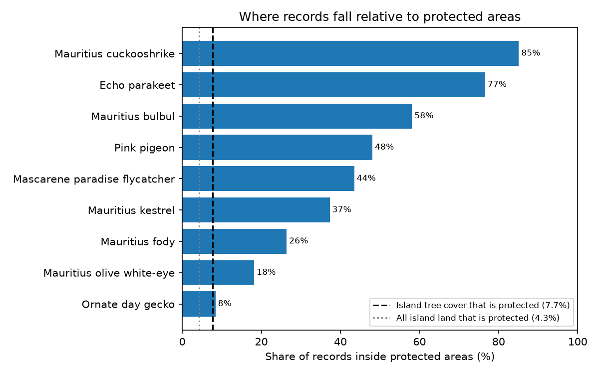
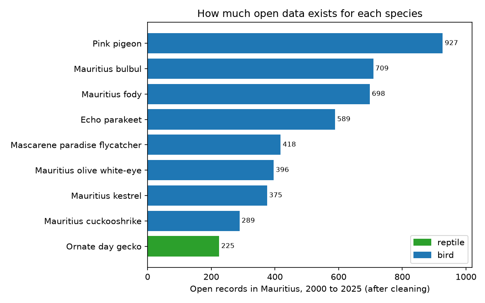
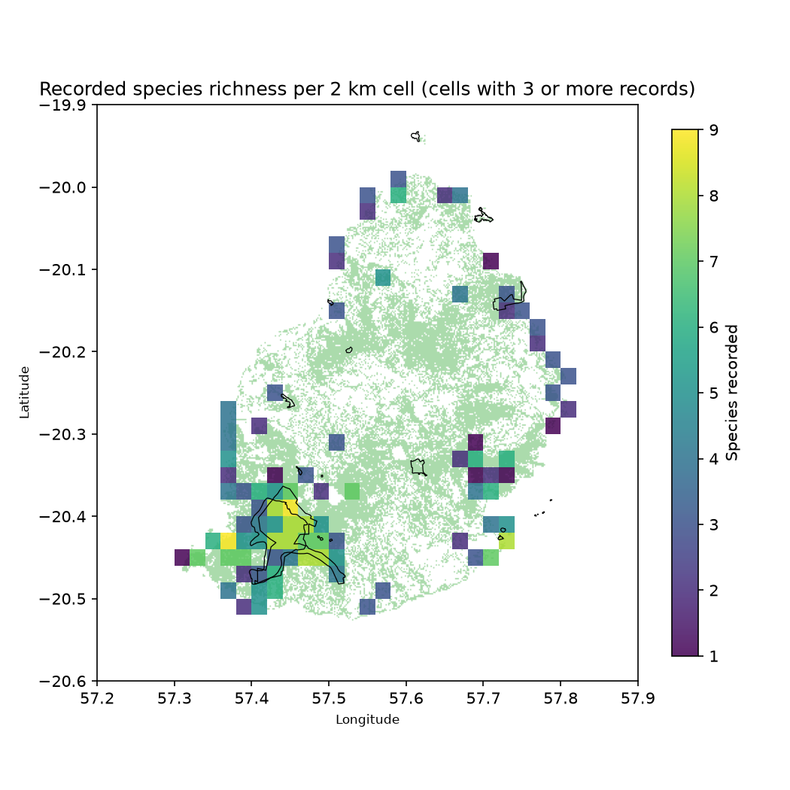

# mauritius-species-atlas


Open-data atlas of endemic animals of Mauritius: records, habitat and protected areas. Python, SQL (DuckDB) and GIS, with tests and CI.



**Status:** v1.0. See [`docs/PROJECT_PLAN.md`](docs/PROJECT_PLAN.md) for the plan, risks and what actually happened.

This is a transparent, modest data analysis, not a scientific study.

## What it does

The project collects open occurrence records of endemic and threatened animals of Mauritius from GBIF, cleans them with documented rules, and links each record to land cover (ESA WorldCover 2021), protected areas (WDPA) and a 2 km grid. It then asks how many records exist, in which land cover they were made, and how many fall inside protected areas, compared with the share of the island's tree cover that is protected.

## Key findings

- Twelve candidate species were checked. Nine have enough records after cleaning (at least 20) and are analysed: eight birds and one gecko. The Mauritian flying fox, Telfair's skink and Guenther's day gecko are data-poor, because most of their open records have blurred or imprecise coordinates.
- Open data is very uneven: of 6,385 records downloaded, 4,626 remain after cleaning, and eBird supplies 82% of them. Eight GBIF datasets contribute in total, and a single coordinate holds 12.7% of the cleaned records.
- Intensive monitoring data is largely lost in cleaning: the SAFRING historical bird ringing records (2005 to 2009) fall from 799 records to 13, mostly because of duplicate records at the same place and date and coordinates outside the island.
- 89% of the cleaned records fall on tree cover. Tree cover is 54% of the island's land in this layer, and it includes plantations and forest invaded by exotic plants, so it is not native forest.
- 46.5% of the cleaned records (2,152 of 4,626) lie inside protected areas, against 7.7% of the island's tree cover and 4.3% of all land. By species the share runs from 8% to 85%. Most of these records are in the Black River Gorges area. This does not show whether the species live there or observers go there.
- Without the one 2 km cell with the most concentrated records, the share of records inside protected areas is 55%, so the figure is sensitive to a single heavily recorded place.

## Results

Share of cleaned records inside protected areas, by species (recorded locations, not distribution):

| Species | IUCN | Records | Inside protected areas |
|---------|:----:|--------:|-----------------------:|
| Mauritius cuckooshrike (Lalage typica) | EN | 289 | 85.1% |
| Echo parakeet (Psittacula eques) | VU | 589 | 76.6% |
| Mauritius bulbul (Hypsipetes olivaceus) | VU | 709 | 58.1% |
| Pink pigeon (Nesoenas mayeri) | VU | 927 | 48.1% |
| Mascarene paradise flycatcher (Terpsiphone bourbonnensis) | LC | 418 | 43.5% |
| Mauritius kestrel (Falco punctatus) | CR | 375 | 37.3% |
| Mauritius fody (Foudia rubra) | EN | 698 | 26.4% |
| Mauritius olive white-eye (Zosterops chloronothos) | CR | 396 | 18.2% |
| Ornate day gecko (Phelsuma ornata) | LC | 225 | 8.4% |
| **All records** | | **4,626** | **46.5%** |

IUCN Red List categories (version 2026-1, checked on 2026-11-10) refer to the whole species, not only to the Mauritius population. GBIF lists Lalage typica as a synonym of Coracina typica; records under both names are included.

Tree cover and protected areas (ESA WorldCover 2021, WDPA Nov 2026; smaller classes omitted):

| Land cover | Area (km²) | Protected (km²) | Protected |
|------------|-----------:|----------------:|----------:|
| Tree cover | 999.1 | 76.6 | 7.7% |
| Grassland | 311.2 | 1.3 | 0.4% |
| Cropland | 385.8 | 0.0 | 0.0% |
| Built-up | 131.6 | 0.0 | 0.0% |
| Mangroves | 3.0 | 0.5 | 17.5% |
| **All land** | **1,844.5** | **78.7** | **4.3%** |

Open records per species, after cleaning:



Recorded species richness in 2 km cells with at least 3 records. The map shows where observers went, not where animals are:



## Quick start

Run everything from the project root.

```powershell
conda env create -f environment.yml
conda activate atlas-mauritius
python -m src.fetch_gbif
python -m src.prepare
# manual step: download the Mauritius WDPA shapefile into data/raw/wdpa/ (see below)
python -m src.protected
python -m src.build_db
python -m src.protected_share
python -m src.make_figures
python -m pytest -q
```

GBIF is updated continuously, so a run on a later date downloads slightly different records, and the counts reported here (retrieved 2026-11-10) can differ a little.

### Manual step: WDPA download

The protected area polygons come from Protected Planet and are not in this repository, because the terms do not allow redistribution.

1. Open https://www.protectedplanet.net/country/MUS, press Download and choose the shapefile format. Check the terms on the site first. This project used the Nov 2026 release (merged WDPA and WD-OECM).
2. Unzip it into `data/raw/wdpa/`. If the zip contains further zip files, unzip those too. `python -m src.protected` looks for any `*polygons.shp` file below that folder.
3. An internet connection is needed on the first runs: `python -m src.prepare` downloads a window of the ESA WorldCover tile, and `python -m src.build_db` installs the DuckDB spatial extension.

## Data and licences

| Source | Use | Licence and citation |
|--------|-----|----------------------|
| GBIF occurrence records | Species records, country MU, 2000 to 2025 | Records carry their own licences (CC0, CC BY, CC BY-NC). Cite GBIF.org, retrieved 2026-11-10, and the datasets below. |
| WDPA and WD-OECM (Protected Planet) | Protected area polygons, Nov 2026 release | UNEP-WCMC and IUCN, Protected Planet. Non-commercial use with attribution, no redistribution. Files are not in this repository: download them from Protected Planet. Check the current terms page. |
| ESA WorldCover 2021 v200 | 10 m land cover | CC BY 4.0, ESA WorldCover (Zanaga et al., 2022). |
| IUCN Red List | Categories typed by hand in `config/species.csv` | IUCN 2026. The IUCN Red List of Threatened Species, version 2026-1, https://www.iucnredlist.org. Categories checked on 2026-11-10. |

GBIF datasets in the cleaned data (4,626 records):

| Dataset | Publisher | Licence | Records |
|---------|-----------|---------|--------:|
| eBird | Cornell Lab of Ornithology | CC BY 4.0 | 3,799 |
| Observation.org Nature data from around the World | Observation.org | CC BY-NC 4.0 | 366 |
| iNaturalist research-grade observations | iNaturalist.org | CC BY-NC 4.0 (dataset level) | 255 |
| Birda - Global Observation Dataset | Birda | CC BY-NC 4.0 | 101 |
| Xeno-canto - Bird sounds from around the world | Vellinga W P, Planqué B | CC BY-NC 4.0 | 62 |
| NABU\|naturgucker | naturgucker.de | CC BY 4.0 | 23 |
| SAFRING: Historical Bird Ringing Records (2005-2009) | Oschadleus D and Ranwashe F | CC BY 4.0 | 13 |
| Macaulay Library Audio and Video Collection | Scholes III Ph.D.E | CC0 1.0 | 7 |

Four of these datasets are CC BY-NC (Observation.org, iNaturalist, Birda, Xeno-canto; 784 of the 4,626 records), and the protected area data are for non-commercial use. This project is therefore a non-commercial portfolio project, and all sources are credited. Results are aggregated, and raw records are not shared.

Raw data are never committed. The scripts download GBIF records and land cover; the WDPA download is the only manual step.

## Method

1. Resolve species names against the GBIF backbone and count records before downloading.
2. Download records per species and cache them.
3. Clean the records with the rules below and keep a log of what each rule removed.
4. Attach a 10 m land cover class and a 2 km grid cell to every record.
5. Load everything into DuckDB, flag records inside protected areas with a spatial join, and answer the five questions with SQL files in `sql/`.
6. Compute how much tree cover lies inside protected areas by painting the polygons onto the land cover raster, and draw three figures.

Protected areas: WDPA Nov 2026, formally designated protected areas (not other conservation measures), terrestrial and coastal polygons inside the island box. Three small islet Nature Reserves that WDPA labels as marine are kept, because they are land habitat. Fishing reserves and the marine park are excluded, because they protect marine habitat. This leaves 20 polygons.

Cleaning log (records removed per rule):

| Rule | Removed | Remaining |
|------|--------:|----------:|
| start | 0 | 6,385 |
| occurrence status is present or detected | 0 | 6,385 |
| no fossil or living (captive) specimens | 0 | 6,385 |
| year within study period | 0 | 6,385 |
| inside island bounding box | 466 | 5,919 |
| coordinate uncertainty within limit (1,000 m) | 599 | 5,320 |
| exact duplicates (species, place, date, dataset) | 657 | 4,663 |
| open water, no land within 1,000 m | 18 | 4,645 |
| species with fewer than 20 records | 19 | 4,626 |

Records with no stated coordinate uncertainty are kept. All records removed by the uncertainty rule come from iNaturalist. The open-water rule came out of checking the hotspot map: three cells lay over open sea, and their records came from one audio recording collection. The island box is a rectangle, so it keeps open sea.

## Responsible data use

- Locations of threatened species can be misused (poaching, disturbance). No exact coordinates are published. Outputs are species-level summaries and aggregated 2 km cells with at least 3 records, and the hotspot map does not show which species were recorded.
- Blurred coordinates (for example iNaturalist records of threatened species) are removed, never recovered.
- Raw GBIF downloads, WDPA files and the DuckDB database are not committed.

## Limitations

- Records are where observers went, not where animals are. A few datasets dominate, mostly eBird. Results describe recorded locations, not distribution.
- Recording is concentrated: one coordinate holds 12.7% of the cleaned records, and almost none of the records in its 2 km cell are inside a protected area. Without that cell the share of records inside protected areas would be 55% instead of 46.5%.
- Coordinates can be generalised or imprecise. Records without stated uncertainty are kept, so many eBird points may be hotspot locations rather than exact sightings. 2.0% of cleaned records fall on water pixels, mostly coastal points. The open-water rule catches only points far out at sea, not misplaced points on land.
- The duplicate rule counts the same species, place, date and dataset once. Counts are distinct combinations, not individual animals, and intensive monitoring data (for example ringing records at one site) is largely collapsed.
- Datasets cover different periods (for example the SAFRING ringing records only 2005 to 2009), so records from different years and sources are not comparable in effort.
- Tree cover is not native habitat: it includes plantations, gardens and invaded forest. The share of tree cover that is protected (7.7%) is therefore not the share of native forest that is protected.
- Land cover is from 2021 while records span 2000 to 2025.
- Protected areas are the current Nov 2026 boundaries, which may be younger than some records. Protection on paper is not effectiveness. Fishing reserves, marine parks and other conservation measures (OECM) are excluded. Only 7 of the 20 polygons contain any record, and most records inside protected areas are in the Black River Gorges area.
- Small numbers for rare species, and three species are too data-poor to analyse. No statistical inference is made.
- Reintroduced and managed populations are included.

## Project management

The plan, risk register and what actually happened are in [`docs/PROJECT_PLAN.md`](docs/PROJECT_PLAN.md). Risks that occurred: unmatched or outdated species names, a different WDPA file structure from the guide (including three islet reserves labelled as marine, found by checking a hotspot cell), blurred and imprecise coordinates (including records over open sea, found in the hotspot map), one dataset and one location dominating, data licences that limit use to non-commercial, GBIF changing after the download, and formatting problems in copied config files.

## Repository structure

```
config/      settings, species list, dataset names and licences
docs/        project plan, one-page summary
src/         Python modules, run with python -m src.<name>
sql/         SQL queries run against DuckDB
outputs/     small result tables, cleaning log, figures
tests/       tests for the cleaning rules and the open-water rule
checks/      diagnostic scripts used during the project
data/        raw and processed data (not committed)
```

## Licence

Code: MIT. Data keep the licences of their sources (see above).
